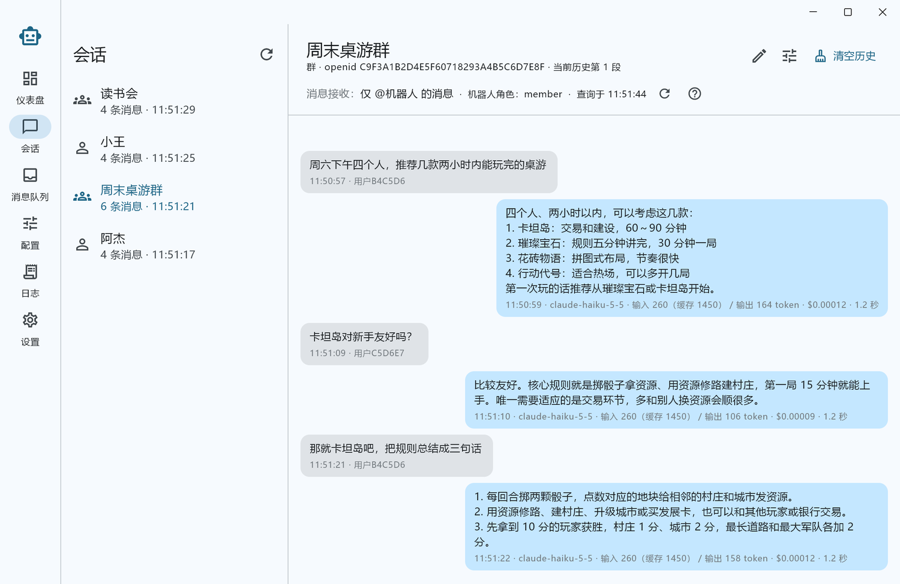
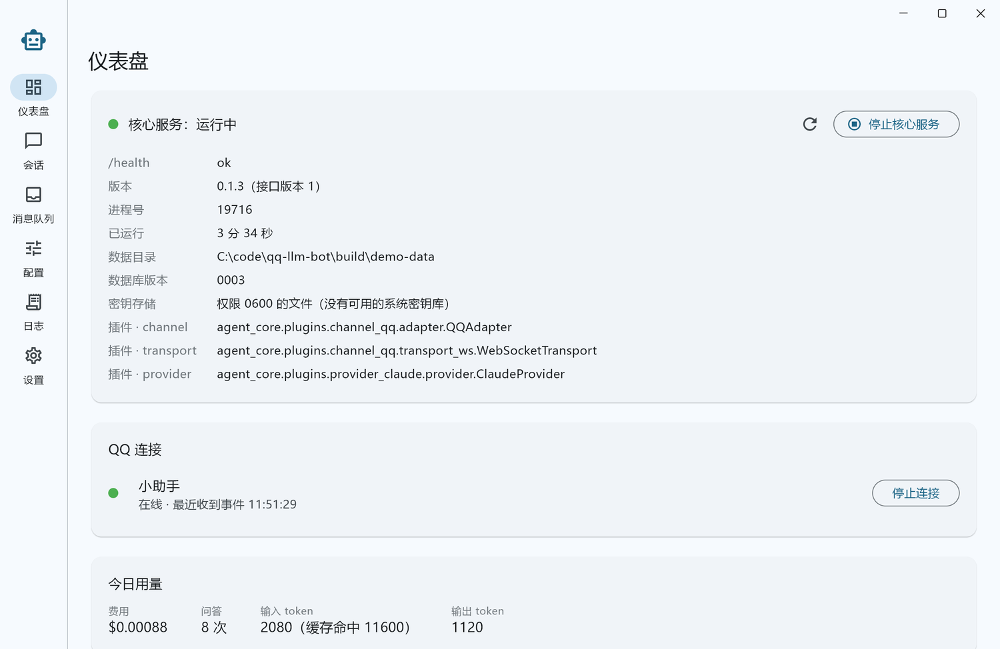
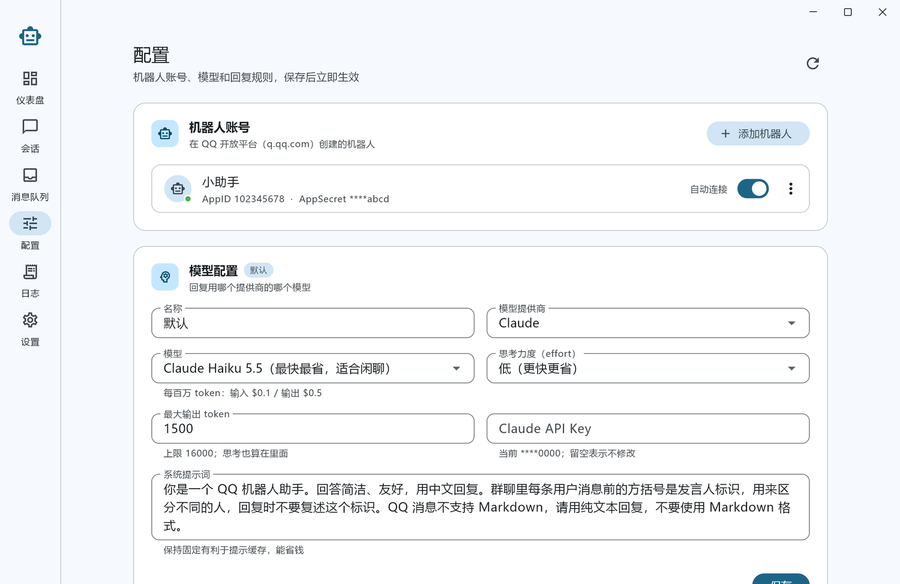
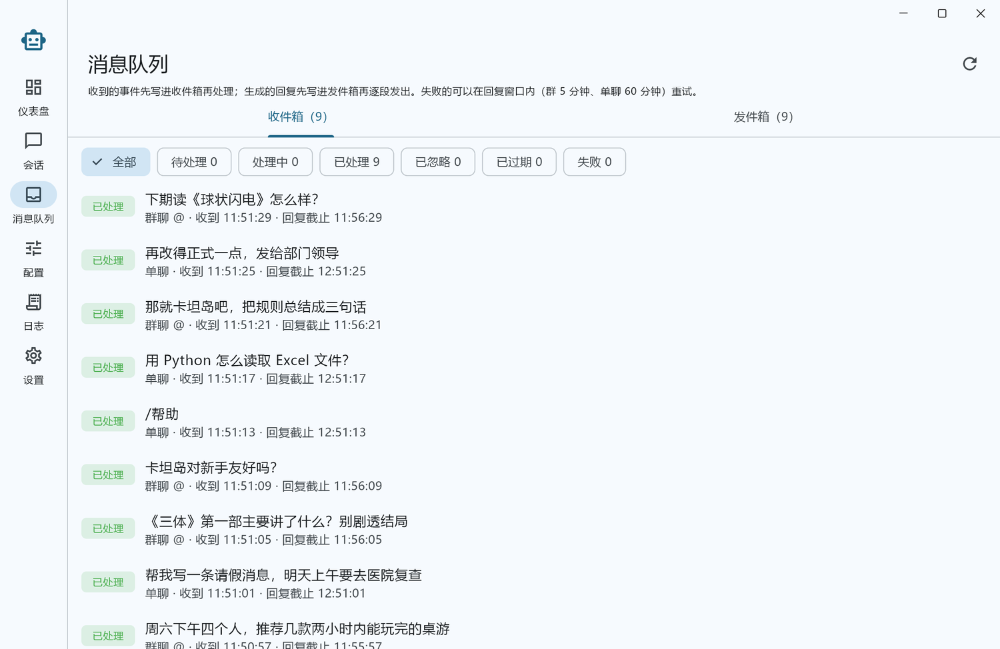
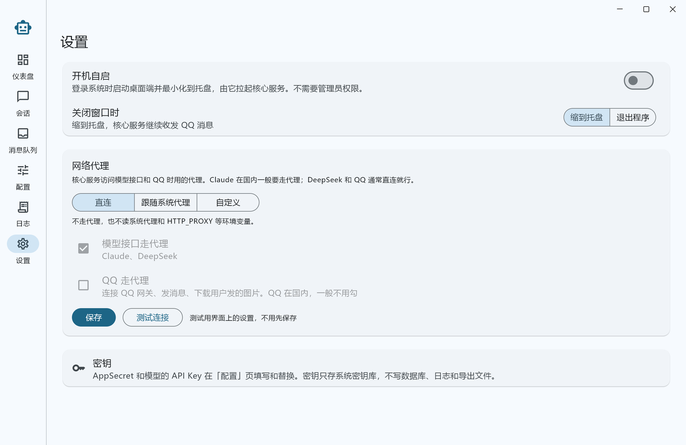

# qq-llm-bot

在你自己电脑上运行的 **QQ 官方机器人 + 大模型对话 Agent**。机器人通过 QQ 开放平台的官方接口收发群聊和单聊消息，用 Claude 或 DeepSeek 生成回复；桌面端负责管理，支持 **Windows / macOS / Linux**。

> **当前状态：可用的早期版本。** 可以在桌面端添加机器人、填写 API Key、启动连接，在群聊和单聊里收发消息，查看会话记录、消息队列和日志，有限频、每日预算和自动清理；三个平台都有便携版。安装版、代码签名和 macOS 公证还没做，见[路线图](#路线图)。



## 界面预览

桌面端左侧是六个页面：仪表盘、会话、消息队列、配置、日志、设置。下面的截图用的是本地模拟的 QQ 和 Claude 接口，群名、用户都是演示数据。

**会话**：每个群和单聊一个会话，可以起备注名。右侧是聊天记录，每条回复下面标着模型、输入 / 输出 token（含缓存命中）、费用和耗时。群会话会显示机器人在群里的消息接收设置（仅 @ / 全部消息）。右上角可以单独给这个会话改配置，或者清空历史从头聊。（见上图）

**仪表盘**：核心服务的运行状态、版本和数据目录，可以手动停止或重新拉起核心服务。下面是每个机器人账号的 QQ 连接状态和启停按钮，以及今天的问答次数、token 用量和费用。



**配置**：添加机器人账号（AppID + AppSecret），设置要不要自动连接。模型配置里选择提供商（Claude / DeepSeek）、模型和思考力度，界面会列出每个模型的价格和输出上限，API Key 只显示末 4 位。往下是全局的机器人行为：回复哪些消息、看不看图、上下文长度和历史压缩、限频、每日预算、数据保留天数等。机器人账号和会话可以通过「单独配置」覆盖这些设置。



**消息队列**：收件箱和发件箱分别列出收到的事件和要发的回复，可以按状态筛选。失败的消息可以在回复窗口内重试，还没发出去的可以取消；点开能看到原始事件和错误信息。



**设置**：开机自启、关闭窗口时缩到托盘还是直接退出、数据目录，以及网络代理。数据目录可以换到别的位置，当前数据会一起复制过去。代理可以选直连、跟随系统代理或自定义，模型接口和 QQ 分别决定走不走代理；保存前可以先测试连接。



**日志**：「运行事件」按级别和类别（连接、断线恢复、发送、模型等）筛选，排查问题时先看这里；「服务日志」是核心服务日志文件的末尾，可以自动刷新。

## 功能特性

- **本地部署**：程序从本机主动连出 QQ 的 WebSocket 网关，不需要公网 IP、域名或服务器。
- **群聊和单聊**：推给机器人的群消息和单聊消息都会回复；群里推哪些（仅 @机器人 / 全部消息）由 QQ 客户端里的群设置决定。
- **看图**：用户发的图片在本机下载后交给模型（每轮最多 4 张，可按全局 / 账号 / 会话关闭；模型不支持看图时只给文字标记）。
- **多轮对话**：每个群、每个单聊各有一份历史。历史太长时自动把较早的部分压成摘要，最近几轮原文保留；Claude 用官方的按需压缩。换了模型提供商也能接着聊。
- **两个独立进程**：Flutter 桌面端 + Python 核心服务。核心服务由桌面端拉起、随桌面端退出；关闭窗口默认缩到托盘，后台继续收发（可在设置里改成直接退出）。核心服务也能单独运行。
- **不丢消息、不重复回复**：消息先写入 SQLite 再处理（收件箱 + 发件箱），按事件 ID 和 `msg_id + msg_seq` 去重；断线后用 Resume 补收，崩溃重启后接着处理。
- **可插拔**：渠道接入方式（当前 WebSocket，预留 Webhook）和模型提供商（当前 Claude 和 DeepSeek，可在模型配置里切换）都是插件，换实现只需改配置。
- **多个机器人账号**，机器人行为按「全局 / 账号 / 会话」三层配置。
- **网络代理**：在设置页选择直连、跟随系统代理或自定义代理（http / https / socks5），模型接口和 QQ 分别决定走不走代理，可以先测试再保存。
- **密钥安全**：AppSecret 和 API Key 存系统密钥库（Windows 凭据管理器、macOS 钥匙串、Linux Secret Service），没有密钥库时退回权限 0600 的文件；不写进数据库、日志和导出文件。
- **控制费用**：默认用 Claude Haiku 5.5（effort 设为 low）；按用户限频；每日预算用完后暂停回复，仪表盘显示当天用量。
- **数据自动清理**：聊天记录和原始事件按保留天数（默认 30 天）每天清理一次，同时备份数据库（保留最近 7 份）。

## 架构概览

```
┌──────────── Flutter 桌面端 ────────────┐        ┌──────────────── agent-core（Python） ────────────────┐
│ 仪表盘 / 会话 / 消息队列 / 配置 / 日志   │  REST  │ control/   FastAPI 控制接口（只监听 127.0.0.1，令牌鉴权）│
│ CoreProcessManager：拉起 / 停止核心服务  │ ─────► │ pipeline/  收件箱 → 中间件 → 调度 → 发件箱              │
│ 托盘、窗口、开机自启、单实例            │ ◄───── │ agent/     对话引擎、上下文、历史压缩、看图             │
└────────────────────────────────────────┘  事件流 │ plugins/   channel_qq、provider_claude、provider_deepseek│
                                                    │ infra/     SQLite（WAL）+ Alembic、keyring、日志          │
                                                    └──────────────┬──────────────────────┬────────────────────┘
                                                                   │ WebSocket / OpenAPI  │ HTTPS
                                                              QQ 开放平台        Claude API / DeepSeek API
```

- 桌面端和核心服务是两个进程，通过本机控制接口通信：REST 管理 + WebSocket 事件流，核心服务启动时生成随机令牌写在数据目录里。
- 核心服务按「端口与适配器」组织：`core/` 只定义接口和统一的数据结构，具体实现放在 `plugins/` 下，通过 Python entry points 登记，启动时按配置装配。
- 收发全部异步：接收只写库，处理和发送由后台任务从数据库取活，按错误码分类重试；群聊被动回复 5 分钟内最多 5 次，单聊 60 分钟内最多 4 次。

完整设计（架构图、时序图、13 张表的字段明细、配置项、跨平台、密钥安全、打包分发）见设计文档：[qq-llm-bot 技术架构设计](https://claude.ai/artifact/5Ti4K1zTsdtZjhBXDisDjf)。

## 快速开始

### 1. 在 QQ 开放平台创建机器人

1. 登录 [QQ 开放平台](https://q.qq.com/)，创建一个机器人。
2. 在机器人的开发设置里拿到 **AppID** 和 **AppSecret**（AppSecret 只显示一次，请妥善保存）。
3. 群聊和单聊事件（`GROUP_AND_C2C_EVENT`）需要单独申请权限。
4. 群里机器人能收到哪些消息（仅 @ / 全部消息）由 **QQ 客户端里的群设置** 决定，应用只能查询、不能修改；推过来的消息机器人都会回复。

### 2. 准备模型的 API Key

Claude 和 DeepSeek 二选一，也可以两个都配，按账号或会话选用不同的模型配置。

- **Claude**（默认）：在 [Claude Console](https://console.anthropic.com/) 创建一个 API Key。建议**为本应用单独建一个工作区和 Key，并给这个工作区设置花费上限**，避免群里有人刷屏导致费用失控。默认模型是 `claude-haiku-5-5`，每条对话大约 0.0003 美元。
- **DeepSeek**：在 [DeepSeek 开放平台](https://platform.deepseek.com/) 创建 API Key，按量从账户余额扣费。`deepseek-flash` 能看图，`deepseek-v4-pro` 推理更强但不能看图；空闲时段半价，界面上按高峰价显示。

### 3. 运行

从 [Releases](https://github.com/jiangtian616/qq-llm-bot/releases) 下载对应平台的便携版，解压即用，不需要安装 Python：

| 平台 | 文件 | 运行 |
| --- | --- | --- |
| Windows 10+（x64） | `qq-llm-bot-<版本>-windows-x64.zip` | 解压后运行 `qq_llm_bot.exe`。首次运行可能出现 SmartScreen 提示，点「更多信息 → 仍要运行」 |
| macOS（Apple 芯片 / Intel） | `qq-llm-bot-<版本>-macos-arm64.zip` / `-macos-x64.zip` | 解压后把 `qq-llm-bot.app` 拖进「应用程序」。应用没有公证，首次打开会被拦截：在「系统设置 → 隐私与安全性」里点「仍要打开」 |
| Linux（x64） | `qq-llm-bot-<版本>-linux-x86_64.AppImage` | `chmod +x` 后直接运行。需要 FUSE（`libfuse2`）；托盘需要 AppIndicator（GNOME 要装扩展） |

数据默认放在系统的用户数据目录（见[数据目录](#数据目录)），和程序文件分开：升级时删掉旧的程序文件夹、解压新版本即可，数据会保留并自动迁移。想放到别的位置，在设置页的「数据目录」里更换。

1. 启动桌面端，仪表盘会自动拉起核心服务。
2. 在「配置」页点「添加机器人」，填写 AppID 和 AppSecret（只存系统密钥库）；在「模型配置」里选择提供商和模型，填写对应的 API Key 并保存。
3. 回到仪表盘，在「QQ 连接」里点「启动连接」，状态变成「在线」后，在群里 @机器人 或私聊它试试。
4. 在群聊或单聊里发 `/清空` 可以清空这个会话的对话历史，`/帮助` 查看指令。

## 从源码构建

需要：

- [Flutter](https://docs.flutter.dev/get-started/install) 3.44+（以及对应平台的桌面开发工具链：Windows 需要 Visual Studio 的「使用 C++ 的桌面开发」，macOS 需要 Xcode，Linux 需要 `clang cmake ninja-build pkg-config libgtk-3-dev`，托盘还需要 `libayatana-appindicator3-dev`）
- [uv](https://docs.astral.sh/uv/)（会自动下载 Python 3.12）

```bash
git clone https://github.com/jiangtian616/qq-llm-bot.git
cd qq-llm-bot
```

安装核心服务的依赖：

```bash
cd agent-core && uv sync
```

单独运行核心服务（`--data-dir` 可省略，默认用系统的用户数据目录）：

```bash
uv run agent-core --data-dir ./.data
```

运行桌面端（在仓库根目录）：

```bash
flutter run -d windows
```

macOS / Linux 把 `windows` 换成 `macos` / `linux`。开发模式下，桌面端会在仓库里找到 `agent-core/.venv` 并直接拉起核心服务；也可以用环境变量 `QQ_LLM_BOT_CORE` 指定核心服务的可执行文件。

### 打包便携版

每个平台在自己的系统上打包（Flutter 和 Nuitka 都不能跨平台编译）：

```bash
uv run --project agent-core --group build python packaging/package.py
```

脚本会用 Nuitka 把核心服务打成自带 Python 运行时的 `agent-core/` 目录，执行 `flutter build <平台> --release`，再把两者放在一起，输出到 `dist/`。需要本机有 C 编译器（Windows 用 Visual Studio，macOS 用 Xcode 命令行工具，Linux 用 gcc 和 `patchelf`）；Linux 还需要 [appimagetool](https://github.com/AppImage/appimagetool)。

推送 `v*` 标签时，GitHub Actions（`.github/workflows/release.yml`）会在 Windows、macOS（Apple 芯片和 Intel）、Linux 上并行打包，并把产物放进一个草稿 Release。

### 更换应用图标

图标由 `assets/branding/` 里的两张主图生成，都是 1024×1024、透明背景的 PNG：`icon.png` 是完整图标，图案铺满画布；`icon_small.png` 是给 32 像素及以下用的简化版。替换主图后运行：

```bash
uv run --no-project --with pillow python packaging/make_icons.py
```

脚本会重新生成 Windows 的 `app_icon.ico`（16～256 共 9 个尺寸）、macOS 的 AppIcon（按 Apple 规范留边并加投影）、托盘图标和 AppImage 用的图标。

### 数据目录

| 平台 | 位置 |
| --- | --- |
| Windows | `%APPDATA%\qq-llm-bot` |
| macOS | `~/Library/Application Support/qq-llm-bot` |
| Linux | `~/.local/share/qq-llm-bot` |

里面有数据库 `agent-core.db`、日志 `logs/`、数据库备份 `backups/`（迁移前的备份和每日备份，每日备份保留最近 7 份）、桌面端偏好 `desktop.json`，以及核心服务运行时的 `control.json`（端口和随机令牌，macOS / Linux 上权限 0600）。

数据目录按下面的顺序决定，用第一个命中的：

1. 环境变量 `QQ_LLM_BOT_DATA_DIR`（核心服务还接受 `--data-dir` 参数）；
2. **便携模式**：程序旁边有 `qq-llm-bot-data` 文件夹时，数据就放在里面。「程序旁边」在 Windows / Linux 免安装包里是可执行文件所在目录，在 macOS 上是 `.app` 所在目录，在 AppImage 里是 AppImage 文件所在目录。安装包不带这个文件夹，新建它就能切换到便携模式；注意升级时如果删掉整个程序文件夹，数据会一起删掉；
3. 设置页「数据目录」里选的自定义目录，路径记在上表系统目录里的 `data-location.json`。更换时可以把当前数据复制过去，或者直接用那个文件夹里已有的数据，完成后程序会重新启动；目录找不到（比如移动硬盘没接）时程序不会启动，而不是悄悄换成空的默认目录；
4. 上表里的系统目录。

0.1.5 及以前的 Windows 包自带 `qq-llm-bot-data` 文件夹（便携模式）。从这些版本升级时，如果旧程序文件夹还在，先退出程序，把里面的 `qq-llm-bot-data` 移到程序目录以外，再到设置页「数据目录」里选它并「使用这里的数据」。

密钥存在系统密钥库里，不在数据目录中，所以数据目录拷到别的电脑后要重新填写 AppSecret 和 API Key。

### 本机控制接口

核心服务只监听 `127.0.0.1`，端口和令牌从 `control.json` 读取，所有请求带 `Authorization: Bearer <token>`：

| 接口 | 说明 |
| --- | --- |
| `GET /health` | 运行状态、版本、数据库版本、密钥存储方式、已装配的插件 |
| `GET /version` | 版本号和接口版本号（桌面端用来检查两端是否兼容） |
| `POST /shutdown` | 平稳停止 |
| `WS /events` | 事件流：连接状态、消息、日志 |
| `GET/POST/PATCH/DELETE /accounts` | 机器人账号；AppSecret 只进不出，返回时只给末 4 位 |
| `GET /accounts/{id}/connection`、`POST .../connection/start`、`.../stop` | 查看和启停 QQ 连接 |
| `GET /providers` | 各模型提供商的模型目录：支持的 effort、默认 effort、输出上限、价格、能不能看图 |
| `GET/POST/PATCH/DELETE /profiles` | 模型配置和 API Key；保存时按模型目录校验 |
| `GET/PUT /settings` | 分层配置（全局 / 账号 / 会话），只接受核心服务认识的配置项 |
| `GET /conversations`、`/conversations/{id}/messages` | 会话列表和聊天记录；另有备注名、清空历史、刷新群状态 |
| `GET /queue/inbox`、`/queue/outbox`（及 `/{id}` 详情） | 收件箱和发件箱；失败的可以重试，待发送的可以取消 |
| `GET /system-events`、`GET /stats`、`GET /logs` | 运行事件、收件箱和发件箱统计、服务日志末尾 |
| `GET /usage/today`、`POST /maintenance/run` | 今天的用量和预算；立即执行一次清理和备份 |
| `POST /network/test` | 用给定的代理设置试连 Claude、DeepSeek 和 QQ 的接口 |

### 数据库迁移

表结构用 Alembic 管理，核心服务启动时自动迁移（迁移前先备份）。修改 `agent_core/infra/db/models.py` 后生成新迁移：

```bash
cd agent-core && uv run alembic revision --autogenerate -m "说明"
```

### 开发调试用的环境变量

| 变量 | 作用 |
| --- | --- |
| `QQ_LLM_BOT_DATA_DIR` | 数据目录 |
| `QQ_LLM_BOT_CORE` | 桌面端拉起的核心服务可执行文件 |
| `QQ_LLM_BOT_QQ_API_BASE` | QQ OpenAPI 地址，指向本地模拟服务做联调 |
| `ANTHROPIC_BASE_URL` | Claude API 地址（官方 SDK 自带） |
| `DEEPSEEK_BASE_URL` | DeepSeek API 地址，默认 `https://api.deepseek.com` |
| `QQ_LLM_BOT_SECRETS=file` | 不用系统密钥库，密钥存数据目录里权限 0600 的文件 |

桌面端拉起核心服务时，这些变量会传给核心服务。

## 目录结构

```
qq-llm-bot/
├─ lib/                       Flutter 桌面端
│  ├─ app/                    AppShell、路由、FeatureRegistry
│  ├─ core/                   api（控制接口客户端）、events（事件流）、connection（连接状态）
│  ├─ platform/               CoreProcessManager、托盘、窗口、开机自启、单实例
│  └─ features/               dashboard、sessions、queue、config、logs、settings（互不引用）
├─ agent-core/                Python 核心服务
│  ├─ agent_core/
│  │  ├─ app/                 入口、插件注册表、启动配置
│  │  ├─ core/                统一数据结构、ports/ 接口、EventBus、连接状态机
│  │  ├─ pipeline/            收件箱、中间件、调度器、发件箱、每日清理与备份
│  │  ├─ agent/               对话引擎（上下文、历史压缩）、图片下载、提示词、工具
│  │  ├─ plugins/             channel_qq/、provider_claude/、provider_deepseek/
│  │  ├─ control/             FastAPI 控制接口
│  │  └─ infra/               数据目录、单实例锁、SQLite + Alembic、密钥存储、日志
│  └─ pyproject.toml          依赖和插件 entry points
├─ windows/ macos/ linux/     Flutter 各平台工程
├─ packaging/                打包脚本：Nuitka 打包核心服务、组装便携版
├─ .github/workflows/        三个平台的构建与发布
├─ docs/screenshots/         README 用的界面截图
└─ assets/                    托盘图标等
```

## 路线图

- [x] 项目骨架：核心服务、控制接口（令牌鉴权、平稳停止、事件流）、13 张表的迁移、密钥存储、插件注册表
- [x] 桌面端骨架：仪表盘（拉起 / 停止核心服务、健康状态、实时事件）、托盘、单实例、开机自启
- [x] QQ：access_token 管理、WebSocket 连接骨架（Identify / 心跳 / Resume）
- [x] QQ 收发全链路：收件箱 → 调度 → 调用 Claude → 发件箱，按错误码重试，崩溃后接着处理
- [x] 账号管理与配置页：添加机器人、填写 AppSecret / API Key、模型配置、全局行为配置
- [x] 账号级和会话级配置：配置页的机器人账号、会话页的会话都可以单独覆盖全局配置
- [x] 会话页（聊天记录、备注名、清空历史、群消息接收设置只读查询）、消息队列页（失败重试、取消）、日志页
- [x] 指令（`/清空`、`/帮助`）、按用户限频、每日预算、数据保留与清理、每日备份
- [x] 图片消息交给模型（历史里只留文字标记，不重复计费）
- [x] 模型配置按提供商的模型目录来；新增 DeepSeek 提供商，换提供商后从中立历史重建上下文
- [x] 历史压缩：超过 token 数或轮数时把较早的部分压成摘要（Claude 用官方按需压缩），最近几轮原文保留
- [x] 打包与分发：Nuitka 打包核心服务，三个平台的便携版，GitHub Actions 构建并发布草稿 Release
- [ ] 安装版（Inno Setup / .dmg / .deb）、代码签名和 macOS 公证
- [ ] 内置开源中文字体，统一三个平台的显示

## 贡献

欢迎提 Issue 和 Pull Request。

- 动手做较大的改动前，先开 Issue 讨论设计。
- 依赖方向只有一个：上层依赖下层和接口。核心服务里 `core/` 不引用 `plugins/`；桌面端里 `features/` 之间不互相引用。
- 和操作系统打交道的代码只放在核心服务的 `infra/` 和桌面端的 `platform/`。
- 密钥不能出现在数据库、日志、导出文件和提交记录里。
- 提交前请确保 `flutter analyze` 没有问题，核心服务能正常启动。

## 许可证

[Apache License 2.0](LICENSE)
